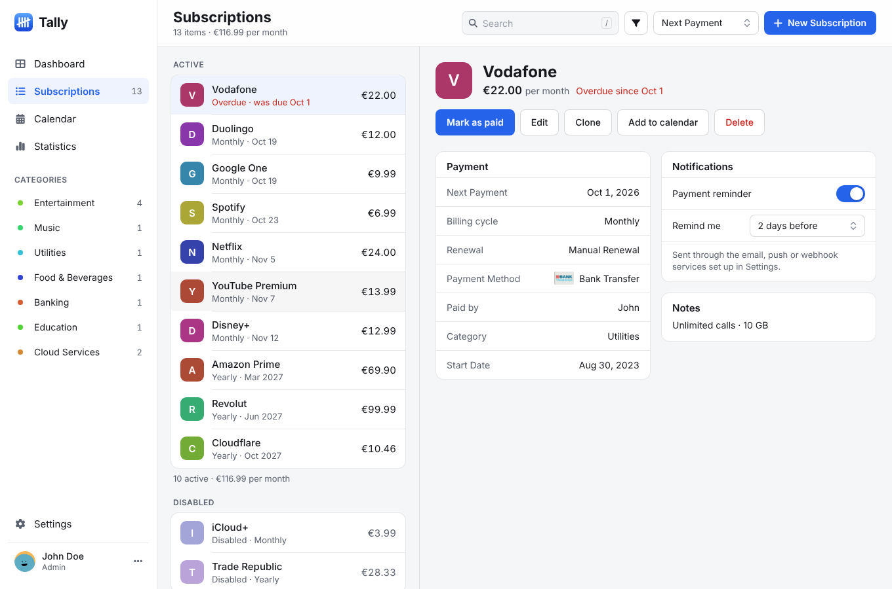
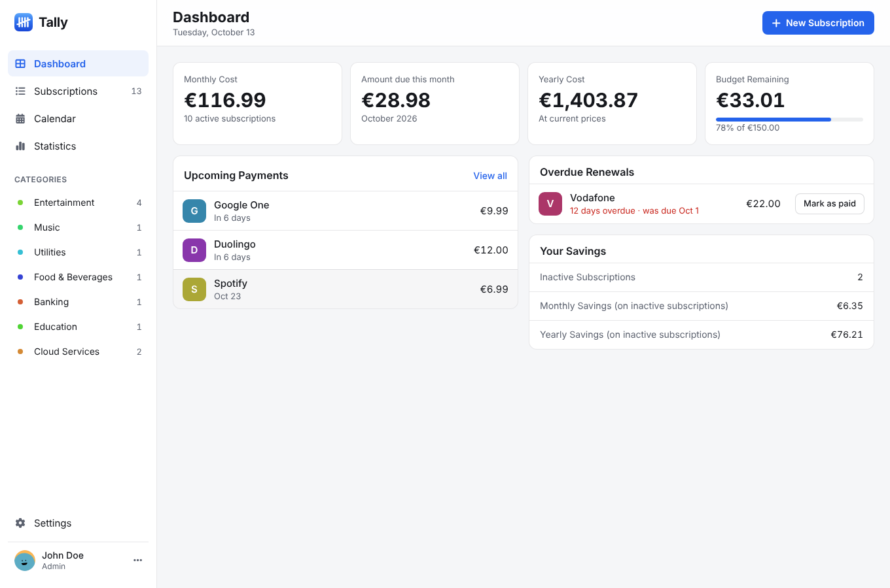
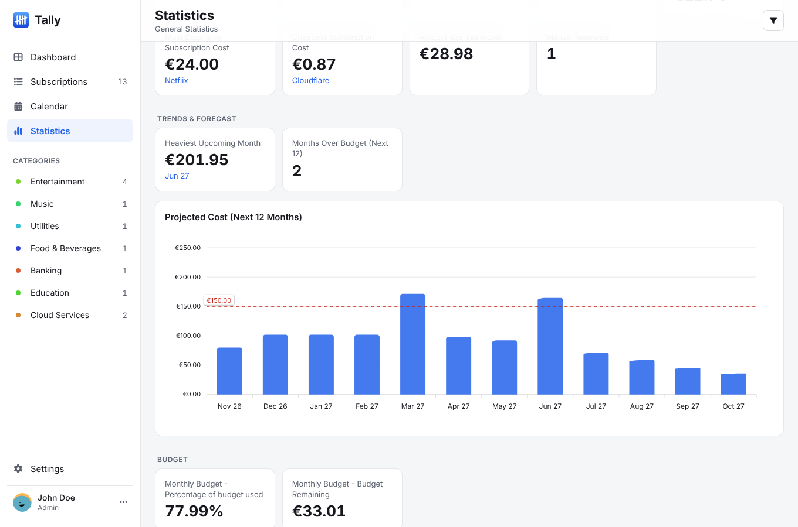
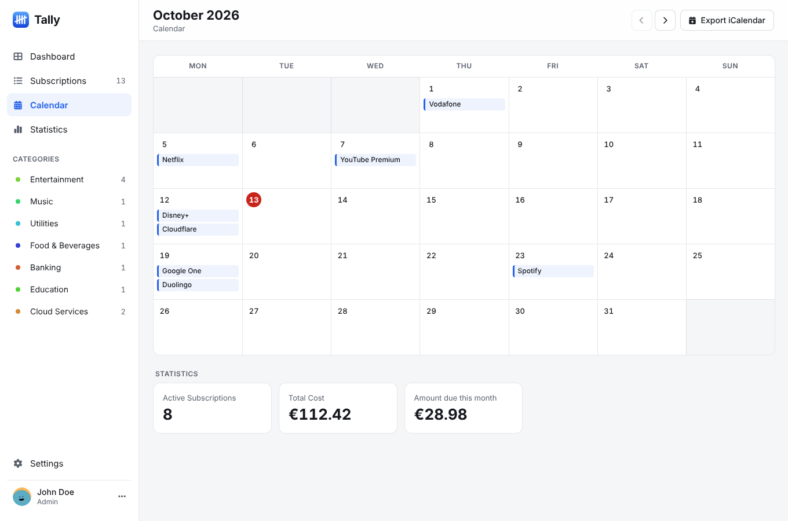
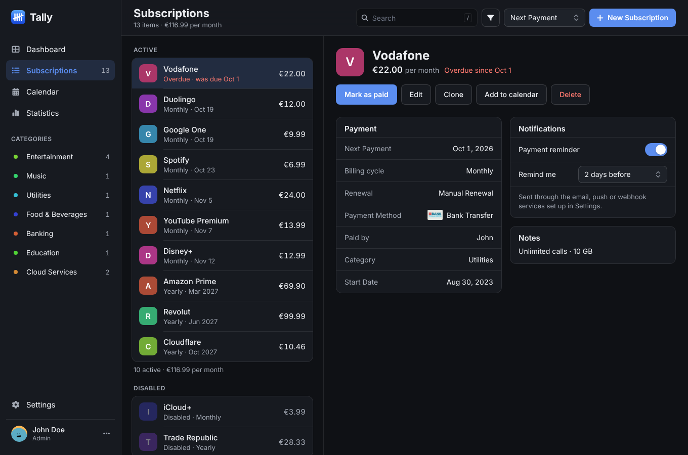
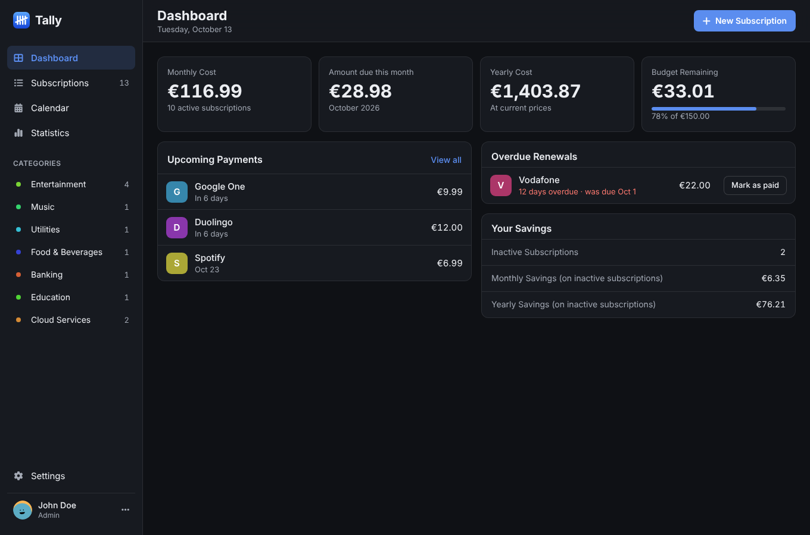
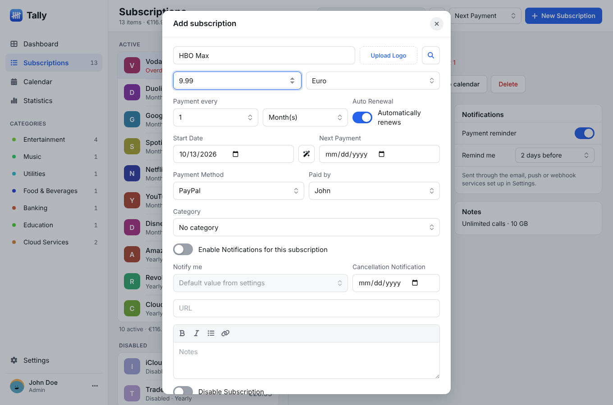
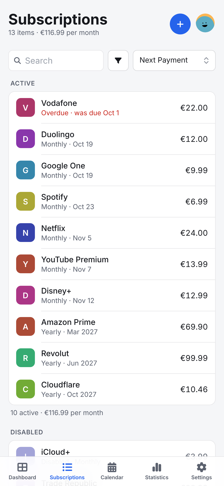
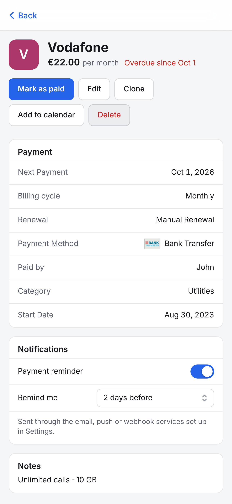
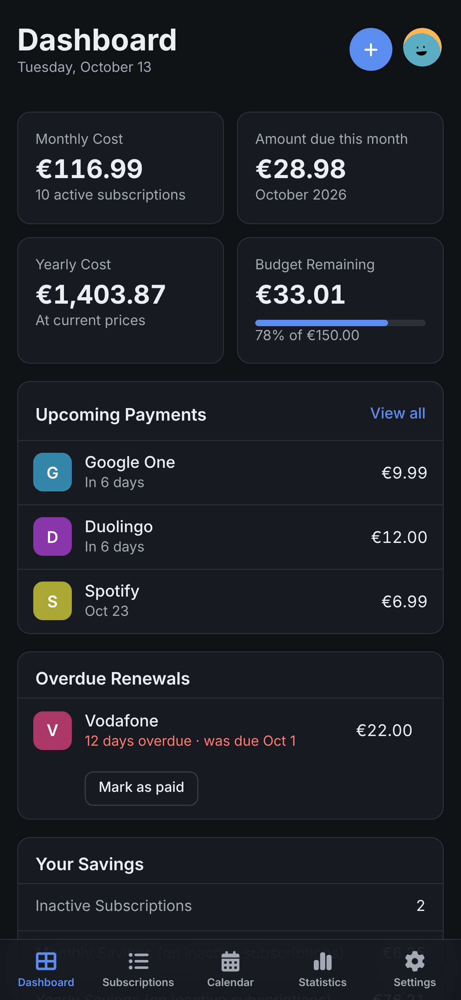

<div align="center">
  <picture>
    <source media="(prefers-color-scheme: dark)" srcset="./images/brand/tally-wordmark-white.png">
    <source media="(prefers-color-scheme: light)" srcset="./images/brand/tally-wordmark.png">
    
  </picture>

  <p><strong>A self-hosted subscription tracker that feels like a native app.</strong></p>

  <p>
    <a href="LICENSE.md"></a>
    <a href="https://github.com/ellite/Wallos"></a>
  </p>
</div>

Tally keeps every recurring payment in one place: what you pay, when it renews, who pays it and what it adds up to. It runs on your own server, so your data stays with you.

It's one web app that adapts to the screen it's on. On a phone you get a bottom tab bar and full-screen details. On a tablet, a sidebar with your categories. On a desktop, the sidebar, list and details side by side. It follows your system's light or dark setting, uses the system font on each platform, and works with a keyboard.

> **Tally is a fork of [Wallos](https://github.com/ellite/Wallos)**, the open-source subscription tracker created by [Henrique](https://henrique.pt) ([@ellite](https://github.com/ellite)) and its contributors. Tally keeps Wallos's features and database format and adds a redesigned interface. It is released under the same GPLv3 license. See [Credits](#credits).



## Contents

- [Features](#features)
- [Screenshots](#screenshots)
- [Getting started](#getting-started)
  - [Docker](#docker)
  - [Docker Compose](#docker-compose)
  - [Bare metal](#bare-metal)
  - [Updating](#updating)
  - [Moving from Wallos](#moving-from-wallos)
- [First steps](#first-steps)
- [Configuration](#configuration)
  - [OIDC](#oidc)
  - [SSRF allowlist](#ssrf-allowlist)
- [API](#api)
- [Development](#development)
- [Contributing](#contributing)
- [Credits](#credits)
- [License](#license)

## Features

- **Subscriptions.** Monthly, yearly, weekly, daily or custom cycles, plus one-time "lifetime" purchases. Automatic or manual renewal, with **Mark as paid** for manual ones.
- **Dashboard.** Monthly and yearly cost, what's due this month, budget left, upcoming payments, overdue renewals and upcoming cancellations at a glance.
- **Reminders.** Per-subscription payment reminders and cancellation reminders by email, browser push, Discord, Telegram, Gotify, Pushover, ntfy, Mattermost, Pushplus, Serverchan or webhooks.
- **Budgets.** A monthly budget and an optional weekly, fortnightly or monthly pay-period budget.
- **Statistics and calendar.** Spending broken down by category, member and payment method, trends and forecasts, and a month calendar you can export to iCalendar.
- **Households.** Track who pays for what.
- **Currencies.** Multi-currency, with exchange rates from Fixer, APILayer or Frankfurter (no key needed).
- **Organisation.** Categories in the sidebar, search, filters and sorting, logos found by web search, notes with Markdown.
- **AI recommendations** (optional) from ChatGPT, Gemini, OpenRouter or a local Ollama model.
- **Sign-in.** Multiple users, two-factor authentication and OIDC / OAuth single sign-on.
- **Installable.** Add it to your home screen or dock as a web app (PWA).
- **Translated** into more than 25 languages.

## Screenshots

| Dashboard | Statistics | Calendar |
| --- | --- | --- |
|  |  |  |

<details>
<summary>More screenshots</summary>







  

</details>

## Getting started

### Docker

```bash
docker run -d --name tally \
  -v /path/to/tally/db:/var/www/html/db \
  -v /path/to/tally/logos:/var/www/html/images/uploads/logos \
  -e TZ=Europe/Berlin -p 8282:80 --restart unless-stopped \
  ghcr.io/theshield2594/tally:latest
```

The image is built and published to the GitHub Container Registry by this repository's [Build & Release workflow](.github/workflows/build-release.yaml). You can also build it yourself from a clone:

```bash
docker build -t tally .
```

Then open `http://<your-server>:8282` and create the first account.

To turn off the container health check (for Docker older than 25, or faster startup reporting), add `--health-cmd=NONE`.

### Docker Compose

```yaml
services:
  tally:
    container_name: tally
    image: ghcr.io/theshield2594/tally:latest
    ports:
      - "8282:80/tcp"
    environment:
      TZ: 'America/Toronto'
    # Volumes keep your data between container upgrades
    volumes:
      - './db:/var/www/html/db'
      - './logos:/var/www/html/images/uploads/logos'
    restart: unless-stopped
```

[docker-compose.yaml](docker-compose.yaml) also lists the optional OIDC and SSRF settings. To turn off the health check, add:

```yaml
    healthcheck:
      test: ["NONE"]
```

### Bare metal

You need NGINX or Apache and PHP 8.3 with these modules: `curl`, `dom`, `gd`, `intl`, `openssl`, `sqlite3`, `zip`, `mbstring` and `fpm`.

1. Clone this repository into your web root, usually `/var/www/html`.
2. Copy `db/wallos.empty.db` to `db/wallos.db`. The file keeps its original name so existing Wallos databases work unchanged.
3. Open the app in your browser. Migrations run automatically on the registration page.
4. Add the scheduled jobs with `crontab -e`:

```bash
0 1 * * * php /var/www/html/endpoints/cronjobs/updatenextpayment.php >> /var/log/cron/updatenextpayment.log 2>&1
0 2 * * * php /var/www/html/endpoints/cronjobs/updateexchange.php >> /var/log/cron/updateexchange.log 2>&1
0 8 * * * php /var/www/html/endpoints/cronjobs/sendcancellationnotifications.php >> /var/log/cron/sendcancellationnotifications.log 2>&1
0 9 * * * php /var/www/html/endpoints/cronjobs/sendnotifications.php >> /var/log/cron/sendnotifications.log 2>&1
*/2 * * * * php /var/www/html/endpoints/cronjobs/sendverificationemails.php >> /var/log/cron/sendverificationemail.log 2>&1
*/2 * * * * php /var/www/html/endpoints/cronjobs/sendresetpasswordemails.php >> /var/log/cron/sendresetpasswordemails.log 2>&1
0 */6 * * * php /var/www/html/endpoints/cronjobs/checkforupdates.php >> /var/log/cron/checkforupdates.log 2>&1
30 1 * * 1 php /var/www/html/endpoints/cronjobs/storetotalyearlycost.php >> /var/log/cron/storetotalyearlycost.log 2>&1
30 3 * * 1 php /var/www/html/endpoints/cronjobs/generaterecommendations.php weekly >> /var/log/cron/generaterecommendations.log 2>&1
0 4 1 * * php /var/www/html/endpoints/cronjobs/generaterecommendations.php monthly >> /var/log/cron/generaterecommendations.log 2>&1
```

If your web root isn't `/var/www/html/`, adjust the paths.

### Updating

- **Docker:** pull the new image and recreate the container. Your `db` and `logos` volumes are kept, and migrations run on startup.
- **Bare metal:** `git pull`, check the PHP modules above, then run the migrations, either by opening `/endpoints/db/migrate.php` while logged in or from the command line:

```bash
php /var/www/html/endpoints/db/migrate.php
```

Tally checks this repository's GitHub releases for new versions and shows a notice to the admin. The repository it checks is set in [`includes/version.php`](includes/version.php).

### Moving from Wallos

Tally uses the same database format and file locations as Wallos, so you can switch in place:

1. Back up your Wallos `db` and `logos` folders. Settings → Backup also works.
2. Point the Tally container (or web root) at the same `db` and `logos` folders.
3. Open Tally. Your accounts, subscriptions and settings are all there.

## First steps

1. Create your account on first launch.
2. Open **Settings** to set a monthly budget, add household members, and adjust categories, currencies and payment methods.
3. For several currencies, pick an exchange-rate provider under **Settings → Fixer API Key**. Frankfurter needs no key.
4. Add your subscriptions with **New Subscription**. Turn on reminders per subscription in its details panel, and choose where reminders go under **Settings → Notifications**.

## Configuration

### OIDC

OIDC single sign-on can be turned on in **Admin**, and works with any provider that supports OAuth. Each `OIDC_*` environment variable overrides the matching database value at runtime without rewriting the database.

If `OIDC_ISSUER` is set, Tally reads `/.well-known/openid-configuration` and uses discovery for the authorization, token and user info endpoints, unless a more specific endpoint variable is also set.

| Environment variable | Admin setting |
| --- | --- |
| `OIDC_ENABLED` | Enable OIDC/OAuth |
| `OIDC_PROVIDER_NAME` | Provider Name |
| `OIDC_CLIENT_ID` | Client ID |
| `OIDC_CLIENT_SECRET` | Client Secret |
| `OIDC_CLIENT_SECRET_FILE` | Client Secret |
| `OIDC_ISSUER` | No direct field |
| `OIDC_AUTH_URL` | Auth URL |
| `OIDC_TOKEN_URL` | Token URL |
| `OIDC_USERINFO_URL` | User Info URL |
| `OIDC_REDIRECT_URL` | Redirect URL |
| `OIDC_LOGOUT_URL` | Logout URL |
| `OIDC_USER_IDENTIFIER` | User Identifier Field |
| `OIDC_SCOPES` | Scopes |
| `OIDC_AUTO_CREATE_USER` | Create user automatically |
| `OIDC_DISABLE_PASSWORD_LOGIN` | Disable password login |
| `OIDC_REQUIRE_EMAIL_VERIFIED` | Require verified email for account linking |

### SSRF allowlist

Tally blocks webhook, SMTP and OIDC URLs that resolve to private, link-local or loopback addresses unless the host is on the allowlist in **Admin → Security Settings**.

To set the allowlist before anyone can log in (for example, an identity provider on your local network), use the `SSRF_ALLOWLIST` environment variable. It takes a comma-separated list of hosts or IPs, optionally with a port, such as `SSRF_ALLOWLIST=auth.example.com,192.168.1.100:8123`. While it's set, it replaces the database value and the field in Admin is read-only.

## API

Tally keeps the Wallos API unchanged, so the [Wallos API documentation](https://api.wallosapp.com/) applies. Authenticate with the API key from your **Profile** page.

## Development

Tally is plain PHP with SQLite and vanilla JavaScript, with no build step. Run it locally with PHP's built-in server:

```bash
cp db/wallos.empty.db db/wallos.db
php -S 127.0.0.1:8080
```

Run the tests:

```bash
php tests/run.php            # every test
php tests/run.php currency   # tests matching "currency"
dev/test.sh                  # the same, inside a throwaway PHP container
```

[`screenshots/capture_screenshots.py`](screenshots/capture_screenshots.py) regenerates the screenshots in this README.

The interface is built from a few shared pieces: the app shell and page toolbar in `includes/header.php`, the design tokens in `styles/theme.css` and `styles/dark-theme.css`, and the components in `styles/styles.css`.

## Contributing

Bug fixes, features and translations are welcome. See [CONTRIBUTING.md](CONTRIBUTING.md) for the workflow and for how to add a language. Please report security issues privately as described in [SECURITY.md](SECURITY.md).

If a fix also applies to Wallos, consider sending it upstream too.

## Credits

Tally exists because of **[Wallos](https://github.com/ellite/Wallos)**, created by [Henrique](https://henrique.pt) ([@ellite](https://github.com/ellite)) and built up by [its contributors](https://github.com/ellite/Wallos/graphs/contributors). Nearly everything that makes Tally work, including subscription handling, notifications, statistics, currencies, OIDC and the API, comes from Wallos. Tally's changes are mainly the redesigned interface and the new name. If you find Tally useful, please consider [supporting Wallos](https://github.com/sponsors/ellite).

Tally also uses:

- [ApexCharts](https://apexcharts.com/) for charts
- [Font Awesome](https://fontawesome.com/) for icons
- [SortableJS](https://sortablejs.github.io/Sortable/) for drag and drop
- [Parsedown](https://parsedown.org/) for notes
- [PHPMailer](https://github.com/PHPMailer/PHPMailer) for email
- [OTPHP](https://github.com/Spomky-Labs/otphp) and [QRCode.js](https://davidshimjs.github.io/qrcodejs/) for two-factor authentication
- Icons by [icons8](https://icons8.com/)
- Payment method icons from the [Credit Cards and Payment Methods Icons](https://www.figma.com/file/5IMW8JfoXfB5GRlPNdTyeg/Credit-Cards-and-Payment-Methods-Icons-(Community)) Figma community file

## License

Tally is licensed under the [GNU General Public License, version 3](LICENSE.md), the same license as Wallos.

That means you can use, study, change and share it. If you distribute a modified version, you must release it under GPLv3 with its source code and keep the existing copyright and license notices.
